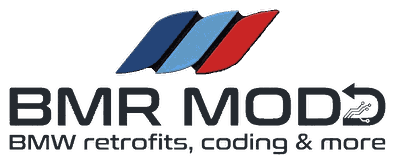

<p align="center">
  
</p>

<h1 align="center">BMRMODZ — BMW MGU Apps</h1>

<p align="center">
  <a href="https://www.instagram.com/bmrmodz">Instagram</a>
  ·
  <a href="https://www.facebook.com/profile.php?id=61590181470490">Facebook</a>
</p>

Independent repository for BMRMODZ's custom BMW MGU / iDrive 7 applications.

## Applications

- **Oil Service Assistant (OSA)** — An independent BMW MGU application for monitoring engine oil, engine coolant and transmission oil temperatures during service procedures.

  - **Engine warm-up:** Monitors engine oil and coolant temperatures, displays live estimates for reaching the selected target temperatures, and compares the current warm-up with previous sessions under similar starting conditions.
  - **Transmission temperature:** Monitors transmission oil temperature and records warm-up and cool-down times to provide useful service-temperature information.
  - **Local history:** OSA records starting temperatures, outside temperature and the time taken to reach target temperatures. Transmission warm-up and cool-down observations are recorded as well. This history is stored locally on the BMW head unit and is used for historical comparisons; it is not uploaded to a cloud service.
  - **Live estimates:** Estimates are based on current temperature trends and driving conditions, while the locally stored history provides a reference from comparable previous sessions.
- **DPF Status** — Read-only diesel particulate filter monitor for BMW iDrive 7. Shows soot and ash mass, regeneration distances and status, plus detailed DPF measurements. Reads data from supported B57 DDE units.

## Build

The repository follows the MGU Store repository format in `mgu-repo.json`.

The repository is configured for **mgu-store** to build OSA on the head unit.
The Store supplies the BMW SDK donor and links the SDK into the app during its
source build. The build script therefore omits `node_modules/oap-sdk` from the
published package; BMW's SDK is not redistributed.

For a standalone local build (outside mgu-store), the SDK must first be extracted
from an app on your own head unit with:

```sh
node kit/tools/extract_sdk.js /path/to/app.js
python3 kit/tools/build.py osa
```

Keep the generated `oap-sdk/` directory local; it is intentionally not committed.

## Credits and licensing

The shared MGU runtime, build tooling and renderer are carried over from the MIT-licensed MGU Custom Apps project. See [LICENSE](LICENSE) and the renderer licenses in `kit/renderd/prebuilt/`.

Only the files required for BMRMODZ applications are included; unrelated apps from the source repository are not copied.
